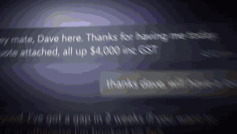

<p align="center">
  
</p>

# Roverlay

Roverlay is a free, open-source Windows app that drafts chat replies with a local AI. Press `Ctrl+Shift+Space` in WhatsApp Web, Messenger, Instagram, Slack, or Discord. Type what you want to say, and the reply appears in the message box in your usual tone with that person. The model runs on your own GPU. There is no account and no cloud, and Roverlay never sends a message for you.

The name is short for "reply overlay".



<sub>The demo is a staged chat page with made-up people, recorded with the real app. [MP4 version](docs/demo.mp4).</sub>

> Roverlay is an early prototype that I built for my own use. It runs on Windows only. I share it as-is and maintain it occasionally.

## What it does

You are in a chat and need to reply. You know what you want to say, but not how to word it.

1. Press `Ctrl+Shift+Space`. A Spotlight-style bar opens over the chat's message box.
2. Type a short instruction, such as `counter at 3.2k and ask if he can start in 2 weeks`, and press `Enter`.
3. Roverlay reads the conversation on screen and writes the reply into the message box.
4. Read it, change it if you want, and press `Enter` in the chat to send it yourself.

If the message box already has text, Roverlay works on that text instead:

- Type an instruction to rewrite your text, such as `make it shorter` or `sound less annoyed`.
- Press `Enter` with an empty bar to tidy your text. Roverlay fixes typos and grammar and keeps your meaning.

## Why local

A reply assistant has to read your private chats. Roverlay keeps them on your PC.

- Roverlay reads the chat with Windows UI Automation. This is the accessibility API that screen readers use. It does not connect to WhatsApp, Slack, or any other app's API, and it does not ask for your logins.
- The model, Qwen3.5 9B, runs on your GPU through llama.cpp. llama.cpp listens only on `127.0.0.1`, so other machines can't reach it.
- Roverlay has no account, no sign-up, and no server of its own.
- Roverlay types the draft into the box and stops. You decide whether to send it.

## Requirements

- Windows 10 or Windows 11.
- An NVIDIA GPU. About 6 GB of graphics memory (VRAM) or more is recommended for the default 9B model. A smaller 4B model is available for GPUs with about 4 GB. Roverlay uses the CUDA build of llama.cpp.
- Google Chrome, for WhatsApp Web, Messenger, and Instagram.
- Disk space for the models: about 5.7 GB for the 9B model or 2.7 GB for the 4B, plus about 0.7 GB for llama.cpp.

## Install

### Download a release

1. Download `Roverlay-0.1.0-windows.zip` from the [Releases page](https://github.com/mmmmingos/roverlay/releases) and unzip it anywhere.
2. Run `Roverlay.exe`. The app isn't code-signed, so Windows SmartScreen may warn you. Choose **More info**, then **Run anyway**.
3. Settings opens on first run. Click **Download** next to the model. Roverlay downloads llama.cpp and the model, then it's ready.

Roverlay then lives in the system tray. Running `Roverlay.exe` again opens Settings.

### Run from source

You need [uv](https://docs.astral.sh/uv/).

```powershell
git clone https://github.com/mmmmingos/roverlay.git
cd roverlay
uv venv --python 3.12
.venv\Scripts\activate
uv pip install -r requirements.txt
python -m roverlay
```

To build the app folder and zip yourself: `uv pip install pyinstaller`, then `python scripts\build.py`.

## Use it

Open a chat, click into it, and press `Ctrl+Shift+Space`.

| Key | Where | What it does |
| --- | --- | --- |
| `Ctrl+Shift+Space` | In a chat | Opens the bar over the message box. |
| `Ctrl+Shift+Space` | While the bar is open | Closes the bar. |
| `Ctrl+Shift+Space` | While a draft is typing | Stops the draft. |
| `Enter` | In the bar, with an instruction | Writes a reply, or rewrites the text already in the box. |
| `Enter` | In the bar, with no instruction | Tidies the text already in the box. |
| `Ctrl+Z` | In the bar | Puts back the text the box had before the rewrite. |
| `Esc` | In the bar | Closes the bar. |
| `Enter` | In the chat | Sends the message. Roverlay never presses this for you. |

Roverlay reads who wrote each message in these apps:

- WhatsApp Web in Chrome.
- Messenger and Instagram on the web in Chrome.
- The Slack desktop app.
- The Discord desktop app.

Other chat sites that label each message with its sender, as accessible sites do, get names too. In any other window, Roverlay still reads the visible text and drafts a reply. It can't tell who said what there, so the draft has less to go on.

Your own messages are labelled **Me**. Roverlay works that out from the layout (WhatsApp, Messenger, Instagram) or from the name the app shows for you (Discord). In Slack and group chats, add the names you use under **Settings > Advanced** if your messages get labelled as someone else's.

## Voice memory

To match how you write to each person, Roverlay keeps a small memory of your chats.

Each time you use it, Roverlay saves the messages that were on screen to a plain-text Markdown file. There is one file per contact:

```text
Documents\Roverlay\voice\<app>\<contact>.md
```

Each line says who wrote it: **Me** for you, the other person's name, or **unsure** when the app gave no reliable way to tell. Roverlay only adds lines it hasn't seen before, keeps the last 200 per contact, and drops older ones. When you draft a reply, it reads your past messages to that person so the draft sounds like you. For example, `Documents\Roverlay\voice\WhatsApp\Dave the tiler.md` could look like this:

```markdown
# Dave the tiler · WhatsApp

Messages Roverlay has seen in this chat, oldest first. **Me** is you; **unsure** means the app gave no reliable way to tell who wrote it. Edit or delete anything; Roverlay only adds to the end.

- 2026-10-28 · **Dave the tiler:** Can do the bathroom for 3.8k all up. Earliest start is next month.
- 2026-10-28 · **Me:** Thanks Dave. Bit over what I had in mind, can you do 3.5?
- 2026-10-28 · **Dave the tiler:** Could do 3.6 if you supply the tiles.
- 2026-10-28 · **Me:** sounds fair, I'll grab the tiles this weekend
```

Windows where Roverlay can't tell who wrote what aren't saved.

You control these files:

- Open or edit any file in a text editor.
- Delete a file to make Roverlay forget that contact.
- Use **Forget everything** in Settings to delete all of them.
- Turn memory off in Settings. Roverlay then reads the chat only when you press the hotkey and saves nothing.

## Settings

Click the Roverlay icon in the system tray to open Settings, or right-click it for **Open settings**, **Pause**, and **Quit**. The settings page has these options:

- **Shortcut.** Change `Ctrl+Shift+Space` to another key combination. It must include `Ctrl`, `Alt` or `Win`.
- **Model.** Choose the 9B model or the smaller 4B model, and download it.
- **Voice memory.** Turn it on or off, open the folder, see which contacts are saved, or use **Forget everything**.
- **Start with Windows.** Launch Roverlay quietly in the tray when you sign in.
- **Paused.** The shortcut does nothing until you turn it off.
- **Advanced.** The names you use in Slack, Discord and group chats, if Roverlay mixes up who is who.

Where things live:

| What | Where |
| --- | --- |
| Voice memory | `Documents\Roverlay\voice` |
| Settings | `%APPDATA%\Roverlay\settings.json` |
| Models and llama.cpp | `%LOCALAPPDATA%\Roverlay\models` |
| Log (timings and counts, never message text) | `%LOCALAPPDATA%\Roverlay\roverlay.log` |

## How it works

When you press the hotkey, Roverlay finds the chat window in the foreground and reads its visible messages through Windows UI Automation. It adds your past messages to that contact from voice memory and your instruction, then sends all of it to a local llama.cpp server running Qwen3.5 9B (Q4_K_M). As the model writes, Roverlay types the reply into the chat's message box. The bar is a small WebView2 window built with pywebview.

```text
Ctrl+Shift+Space
      |
      v
Windows UI Automation reads the visible chat
      |
      +--> adds your past messages to this contact from voice memory
      |
      v
llama.cpp on 127.0.0.1 runs Qwen3.5 9B on your GPU
      |
      v
Reply is typed into the message box. You press Enter.
```

## Performance

I measured these numbers on my own PC only. Your results depend on your GPU and on the length of the chat.

The PC has an RTX 3060 Ti with 8 GB, an i5-13600KF, 32 GB of RAM, and Windows 10. It runs the 9B model.

| Step | Time on that PC |
| --- | --- |
| Bar opens | About 20 ms |
| Bar is ready to type in | About 35 ms |
| Reading the chat | 0.4 to 0.9 s |
| First words of the draft appear | About 0.45 s |
| Draft finishes | About 1 to 2.5 s, longer for longer chats |

The 9B model uses about 5.6 GB of graphics memory on that PC.

## FAQ

### Is there an offline AI that replies to WhatsApp messages?

Roverlay drafts WhatsApp replies with an AI model that runs on your own PC. It reads WhatsApp Web in Chrome through the Windows accessibility API, so it needs no WhatsApp API or account link. It writes the reply into the message box and never sends it. You still need internet for WhatsApp Web itself.

### Does Roverlay send my messages anywhere?

No. Roverlay reads your chats on your PC and sends them to a llama.cpp server on the same PC, at `127.0.0.1`. Roverlay goes online only when you click **Download** in Settings, to fetch llama.cpp from GitHub and the model from Hugging Face. Roverlay's own code has no update checks, analytics or telemetry, and its pages load nothing from the internet. Voice memory is plain Markdown in your Documents folder, and you can delete it at any time.

### Which chat apps does it work with?

WhatsApp Web, Messenger, and Instagram in Chrome, plus the Slack and Discord desktop apps. Roverlay can also draft in other windows, but there it can't tell who wrote each message. Slack support is partial. Roverlay reads only part of the visible conversation in Slack.

### Is there a local alternative to Grammarly or Wispr Flow?

Roverlay covers one part of what those tools do. It drafts, rewrites, and tidies chat messages on your own GPU, with no account. It has no voice dictation, and it is built for chat windows, not for every text field. If you mainly want help with replies and want them to stay on your PC, it may fit.

### Can an AI write replies in my own tone?

Yes. Roverlay keeps your recent messages to each contact in a Markdown file and uses them when it drafts. A reply to your landlord can sound different from a reply to your brother. You can turn this memory off.

### Does it work on Mac or Linux?

No. Roverlay runs on Windows 10 and 11 only. It depends on Windows UI Automation to read chats, so a Mac version would need a different chat reader.

### What GPU do I need to run a local AI reply assistant?

An NVIDIA GPU with about 6 GB of VRAM or more runs the default Qwen3.5 9B model. On a GPU with about 4 GB, choose the 4B model in Settings.

## Limitations

- Rewrites don't always follow your instruction well.
- In Slack, Roverlay reads only part of the visible conversation.
- If you type at the same instant you press the hotkey, a letter can land in the chat.
- Roverlay is untested in Windows light mode.
- Roverlay runs on Windows only, and needs an NVIDIA GPU for the CUDA build of llama.cpp.
- The app isn't code-signed, so Windows SmartScreen warns on first launch.

## Credits

- The bar's design comes from [DigUp](https://github.com/ARahim3/DigUp) by ARahim3 (MIT license).
- [llama.cpp](https://github.com/ggml-org/llama.cpp) runs the model.
- [Qwen3.5](https://github.com/QwenLM) is the language model.
- [pywebview](https://github.com/r0x0r/pywebview) draws the bar with Microsoft WebView2.

Roverlay is built by Ming Xu ([@mingmakesstuff](https://x.com/mingmakesstuff) on X, [mmmmingos](https://github.com/mmmmingos) on GitHub).

## License

MIT. See [LICENSE](LICENSE).
